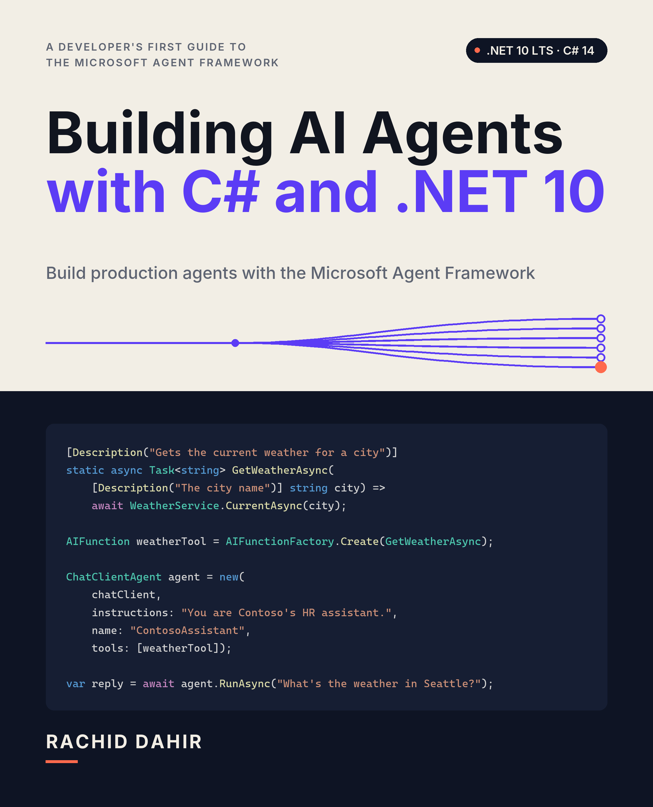

# Building AI Agents with C# and .NET 10, Second Edition

<p align="center">
  
</p>

<p align="center"><strong>From First Agent to Reliable Production Systems with Microsoft Agent Framework</strong></p>

<p align="center"><sub>Companion code, errata and reader feedback for the second edition, by Rachid Dahir. The first edition's code is under the tag <code>v1.1.0-maf-1.28.0</code> (see <a href="#first-edition">First edition</a>).</sub></p>

---

## What's in the book

The book builds AI agents in C# with the **Microsoft Agent Framework (MAF) 1.28** on **.NET 10** (LTS) and **C# 14**. It has six parts, 24 chapters and seven appendices, and one running example, Contoso's expense assistant, grows through eight versions (v0 to v7) from a first agent to a qualified release candidate. Payments are simulated: no sample moves real money.

The appendices are: A, C# Essentials for AI Development; B, Package Manifest and Qualification Scope; C, Migrating from Semantic Kernel and AutoGen (the full guides are in [`docs/migration`](./docs/migration/README.md)); D, Glossary; E, Exercise Solutions and Project Mapping; F, Troubleshooting by Symptom; and G, References and Evidence.

Most samples have a `--self-test` mode. It runs against a scripted chat client, needs no model and no key, prints `RESULT n/n` and exits non-zero when a check fails, so the [build workflow](.github/workflows/build.yml) runs them all.

## Companion code

<!-- The two generated blocks below are written by tools/readme-counts.ps1 from AgenticAI.slnx.
     CI fails when they disagree with the solution. After adding or removing a project, run:
     pwsh tools/readme-counts.ps1 -Write -->
<!-- BEGIN generated:counts -->
**177 projects** in `AgenticAI.slnx`:

- **122** under [`src/`](./src): the samples of 24 chapters, Appendix A, and the shared libraries in `src/Common`
- **47** worked exercise solutions under [`exercises/`](./exercises), in 18 folders
- **8** Contoso versions under [`contoso/`](./contoso) (v0-v7)

171 are runnable and 6 are libraries (`AgenticAI.Common`, `AgenticAI.Common.Anthropic`, `AgenticAI.Common.Azure`, `AgenticAI.Common.Foundry`, `AgenticAI.Testing`, `Ch17.AspireOrchestration.ServiceDefaults`). 124 projects have an offline `--self-test` mode.
<!-- END generated:counts -->

Each project is self-contained, so pick the one for the chapter you're reading. Open `AgenticAI.slnx` once and every project loads together.

### Projects by chapter

Folder and project names carry the second-edition chapter number. The **Exercises** column counts the worked solutions in that chapter's `exercises/ChNN.Exercises` folder; where a chapter has none, its exercises extend the chapter's projects in place, and Appendix E has the solution notes.

<!-- BEGIN generated:projects -->
#### Part I: Understand and Start

10 chapter projects, 7 exercise projects.

| Ch | Chapter | Projects | Exercises |
|---:|---|---|---|
| 1 | Choosing the Right Amount of Agency | [`src/Ch01.Agency`](./src/Ch01.Agency) (1): `Ch01.FirstGlimpse` | 0 |
| 2 | Models, Context and Capabilities | [`src/Ch02.ModelsContext`](./src/Ch02.ModelsContext) (2): `Ch02.CapabilityProfile`, `Ch02.TokenExplorer` | [2](./exercises/Ch02.Exercises) |
| 3 | A Reproducible Development Environment | [`src/Ch03.DevEnvironment`](./src/Ch03.DevEnvironment) (3): `Ch03.AnthropicCall`, `Ch03.FirstLlmCall`, `Ch03.FoundryAgent` | [2](./exercises/Ch03.Exercises) |
| 4 | Your First Agent and Its First Test | [`src/Ch04.FirstAgent`](./src/Ch04.FirstAgent) (4): `Ch04.AgentTests`, `Ch04.BasicAgent`, `Ch04.MinimalApiAgent`, `Ch04.StreamingAgent` | [3](./exercises/Ch04.Exercises) |

#### Part II: Contracts and Authorized Actions

23 chapter projects, 12 exercise projects.

| Ch | Chapter | Projects | Exercises |
|---:|---|---|---|
| 5 | Typed Responses and Domain Validation | [`src/Ch05.TypedResponses`](./src/Ch05.TypedResponses) (5): `Ch05.DomainValidation`, `Ch05.EntityExtraction`, `Ch05.ResponseFormat`, `Ch05.RobustExtraction`, `Ch05.TypedResponses` | [3](./exercises/Ch05.Exercises) |
| 6 | Conversations, Memory and Data Ownership | [`src/Ch06.ConversationsMemory`](./src/Ch06.ConversationsMemory) (7): `Ch06.AgentSessionDemo`, `Ch06.ContextBudget`, `Ch06.ContextProviderDemo`, `Ch06.PersistentSession`, `Ch06.ServiceManagedState`, `Ch06.SessionOwnership`, `Ch06.StatelessDemo` | [5](./exercises/Ch06.Exercises) |
| 7 | Tools and Bounded Execution | [`src/Ch07.Tools`](./src/Ch07.Tools) (7): `Ch07.CalculatorTool`, `Ch07.DatabaseLookupTool`, `Ch07.FileAccess`, `Ch07.LoopControl`, `Ch07.ShellTool`, `Ch07.ToolChoice`, `Ch07.WeatherTool` | [3](./exercises/Ch07.Exercises) |
| 8 | Authorizing and Committing Agent Actions | [`src/Ch08.AuthorizedActions`](./src/Ch08.AuthorizedActions) (4): `Ch08.ActionPolicy`, `Ch08.IdempotentCommit`, `Ch08.ToolApproval`, `Ch08.UncertainOutcome` | [1](./exercises/Ch08.Exercises) |

#### Part III: Knowledge and Documents

19 chapter projects, 9 exercise projects.

| Ch | Chapter | Projects | Exercises |
|---:|---|---|---|
| 9 | MCP Across Trust Boundaries | [`src/Ch09.MCP`](./src/Ch09.MCP) (6): `Ch09.KnowledgeBaseMcp`, `Ch09.McpAccessTests`, `Ch09.McpConsumer`, `Ch09.McpHttpServer`, `Ch09.McpServer`, `Ch09.ProtectedMcpServer` | [4](./exercises/Ch09.Exercises) |
| 10 | Building a Grounded RAG Baseline | [`src/Ch10.RAGBaseline`](./src/Ch10.RAGBaseline) (5): `Ch10.EmbeddingsDemo`, `Ch10.FaqAgent`, `Ch10.HostedFilesRag`, `Ch10.RagPipeline`, `Ch10.RetrievalEval` | [2](./exercises/Ch10.Exercises) |
| 11 | RAG With Permissions, Freshness and Evidence | [`src/Ch11.RAGPermissions`](./src/Ch11.RAGPermissions) (4): `Ch11.AuthorizedSearch`, `Ch11.HybridRetrieval`, `Ch11.ScopedCache`, `Ch11.VersionedIngestion` | 0 |
| 12 | Reliable Multimodal Document Processing | [`src/Ch12.MultimodalDocuments`](./src/Ch12.MultimodalDocuments) (4): `Ch12.ImageToTypedData`, `Ch12.Multimodal.Tests`, `Ch12.ReceiptExtraction`, `Ch12.VisionBasics` | [3](./exercises/Ch12.Exercises) |

#### Part IV: Composition and Durable Execution

29 chapter projects, 5 exercise projects.

| Ch | Chapter | Projects | Exercises |
|---:|---|---|---|
| 13 | Choosing a Multi-Agent Topology | [`src/Ch13.MultiAgentTopology`](./src/Ch13.MultiAgentTopology) (9): `Ch13.ConcurrentOrchestration`, `Ch13.GroupChatOrchestration`, `Ch13.HandoffOrchestration`, `Ch13.MagenticOrchestrator`, `Ch13.MultiAgent.Tests`, `Ch13.OrchestratorPattern`, `Ch13.SequentialPipeline`, `Ch13.StreamingPipeline`, `Ch13.TopologyComparison` | [2](./exercises/Ch13.Exercises) |
| 14 | Workflows, Branches and Human Review | [`src/Ch14.Workflows`](./src/Ch14.Workflows) (9): `Ch14.AgentWorkflow`, `Ch14.ApprovalWorkflow`, `Ch14.CheckpointedApproval`, `Ch14.ConditionalWorkflow`, `Ch14.LoopEngineering`, `Ch14.ParallelAnalysis`, `Ch14.SequentialWorkflow`, `Ch14.SubWorkflow`, `Ch14.WorkflowTests` | [2](./exercises/Ch14.Exercises) |
| 15 | Durable Execution and External Effects | [`src/Ch15.DurableExecution`](./src/Ch15.DurableExecution) (3): `Ch15.DurableReview`, `Ch15.ExternalEffects`, `Ch15.RestartTests` | [1](./exercises/Ch15.Exercises) |
| 16 | Skills, Harnesses and Capability Lifecycle | [`src/Ch16.SkillsHarnesses`](./src/Ch16.SkillsHarnesses) (8): `Ch16.AgentSkills`, `Ch16.CodingAgent`, `Ch16.HarnessBackgroundAgents`, `Ch16.HarnessBasics`, `Ch16.HarnessComposition`, `Ch16.HarnessFiles`, `Ch16.HarnessLoop`, `Ch16.SkillLifecycle` | 0 |

#### Part V: Interfaces, Security and Observation

22 chapter projects, 9 exercise projects.

| Ch | Chapter | Projects | Exercises |
|---:|---|---|---|
| 17 | Hosting, Identity and Tenant Isolation | [`src/Ch17.HostingIdentity`](./src/Ch17.HostingIdentity) (5): `Ch17.A2APreview`, `Ch17.AspireOrchestration.AppHost`, `Ch17.AspireOrchestration.ServiceDefaults`, `Ch17.AspNetCoreHost`, `Ch17.IdentityTests` | [3](./exercises/Ch17.Exercises) |
| 18 | Streaming Interfaces and Approval Experiences | [`src/Ch18.StreamingInterfaces`](./src/Ch18.StreamingInterfaces) (5): `Ch18.AguiClient`, `Ch18.AguiServer`, `Ch18.ApprovalUi`, `Ch18.InterfaceTests`, `Ch18.SseStatusStream` | 0 |
| 19 | Observability, Quality and Incident Diagnosis | [`src/Ch19.Observability`](./src/Ch19.Observability) (2): `Ch19.IncidentDiagnosis`, `Ch19.OpenTelemetryAgent` | [2](./exercises/Ch19.Exercises) |
| 20 | Security Policies and Governance | [`src/Ch20.SecurityGovernance`](./src/Ch20.SecurityGovernance) (10): `Ch20.ConsumptionLimits`, `Ch20.ContentSafety`, `Ch20.CriticAgent`, `Ch20.IndirectInjection`, `Ch20.InputSanitization`, `Ch20.MessageInjector`, `Ch20.MiddlewarePipeline`, `Ch20.OutputHandling`, `Ch20.PolicyEnforcement`, `Ch20.ThreatRegisterTests` | [4](./exercises/Ch20.Exercises) |

#### Part VI: Qualification and Operations

12 chapter projects, 1 exercise project.

| Ch | Chapter | Projects | Exercises |
|---:|---|---|---|
| 21 | Evaluation With Evidence and Uncertainty | [`src/Ch21.Evaluation`](./src/Ch21.Evaluation) (6): `Ch21.EvalSuite`, `Ch21.EvalTests`, `Ch21.EvidenceEval`, `Ch21.FaqEval`, `Ch21.JudgeCalibration`, `Ch21.RedTeam` | 0 |
| 22 | Cost, Latency and Capacity Engineering | [`src/Ch22.CostCapacity`](./src/Ch22.CostCapacity) (3): `Ch22.CostModel`, `Ch22.LoadProfile`, `Ch22.ModelRouting` | [1](./exercises/Ch22.Exercises) |
| 23 | Qualifying the Contoso Agent System | [`src/Ch23.Qualification`](./src/Ch23.Qualification) (1): `Ch23.QualificationRunner` | 0 |
| 24 | Operating and Evolving Agents | [`src/Ch24.Operations`](./src/Ch24.Operations) (2): `Ch24.KillSwitch`, `Ch24.RestoreDrill` | 0 |

#### Outside the chapters

| Folder | Projects |
|---|---|
| [`src/AppA.CSharpEssentials`](./src/AppA.CSharpEssentials), Appendix A | 2: `AppA.ConsoleApp`, `AppA.MinimalApi` |
| [`exercises/AppA.Exercises`](./exercises/AppA.Exercises), Appendix A | 4: `Ex01.RecordPatterns`, `Ex02.AsyncFileProcessor`, `Ex03.MinimalApiCrud`, `Ex04.JsonRoundTrip` |
| [`src/Common`](./src/Common), shared libraries | 5: `AgenticAI.Common`, `AgenticAI.Common.Anthropic`, `AgenticAI.Common.Azure`, `AgenticAI.Common.Foundry`, `AgenticAI.Testing` |
| [`contoso/`](./contoso), the running example | 8: `Contoso.AgentFakeModel`, `Contoso.OwnedConversation`, `Contoso.AuthorizedReimbursement`, `Contoso.FaqEvidence`, `Contoso.Receipts`, `Contoso.DurableResume`, `Contoso.ApiUi`, `Contoso.Qualified` |
<!-- END generated:projects -->

`Ch13.MagenticOrchestrator` and `exercises/AppA.Exercises/Ex02.AsyncFileProcessor` are in the repository but not printed in the book.

### Contoso, v0 to v7

Each version has its own folder under [`contoso/`](./contoso) and a README. v0, v1 and v2 stand alone. From v3 on, a version references the one it extends: v3 and v4 build on v2, v5 on v4, v6 on v5 and v7 on v6. Opening v5 brings v4 and v2 along, so any version runs without the earlier chapters.

| Version | Folder | Built in | What it adds |
|---|---|---|---|
| v0 · Agent and fake model | [`v0-agent-fake-model`](./contoso/v0-agent-fake-model) | Chapter 4 | The assistant as an agent with instructions, checked against a scripted fake model before any model is called |
| v1 · Owned conversation | [`v1-owned-conversation`](./contoso/v1-owned-conversation) | Chapter 6 | Conversations that survive a restart, belong to one employee and can be deleted |
| v2 · Authorized reimbursement | [`v2-authorized-reimbursement`](./contoso/v2-authorized-reimbursement) | Chapter 8 | The model proposes a reimbursement, application policy decides, and the commit happens once, with an explicit outcome when the result is uncertain |
| v3 · FAQ with evidence | [`v3-faq-evidence`](./contoso/v3-faq-evidence) | Chapters 10 and 11 | Policy answers grounded in handbook passages the employee may see, with citations checked against what was retrieved; no evidence, no answer |
| v4 · Receipts | [`v4-receipts`](./contoso/v4-receipts) | Chapter 12 | Receipt images read into typed fields and validated; an amount nobody can read goes to a reviewer, not to payment |
| v5 · Durable resume | [`v5-durable-resume`](./contoso/v5-durable-resume) | Chapter 15 | A claim waiting for review survives the loss of its process; the payment happens once or ends as an explicit unknown |
| v6 · API and interface | [`v6-api-ui`](./contoso/v6-api-ui) | Chapters 17 and 18 | An HTTP API with a validated identity on every request, and an interface that shows operation state and lets a reviewer approve exact arguments |
| v7 · Qualified version | [`v7-qualified`](./contoso/v7-qualified) | Chapter 23 | v6 frozen as an identifiable candidate, with a candidate manifest, an acceptance matrix, a release dossier and its known limits |

## Recommended path

New to agents? Read the book in order: Parts I and II are the base everything else stands on, and Chapter 8 is the one the rest of the book keeps returning to. In the code, start with:

1. `src/Ch03.DevEnvironment/Ch03.FirstLlmCall`: one call to a model, and `--config-check` to see which settings load.
2. `src/Ch04.FirstAgent/Ch04.BasicAgent` and `Ch04.AgentTests`: the first agent and its first test.
3. `src/Ch05.TypedResponses/Ch05.DomainValidation`: a typed result checked first for shape, then against the domain rules.
4. `src/Ch06.ConversationsMemory/Ch06.SessionOwnership`: a stored conversation that belongs to one person.
5. `src/Ch07.Tools/Ch07.LoopControl`: the limits on the tool-calling loop.
6. `src/Ch08.AuthorizedActions/Ch08.ActionPolicy` and `Ch08.IdempotentCommit`: the application decides, and the commit happens once.
7. `contoso/v0-agent-fake-model` to `contoso/v2-authorized-reimbursement`: the same ideas composed into one assistant.

Run each with `--self-test` where it has one (all of these except `Ch04.BasicAgent`), then against a model. The full outputs of the runs printed in the book, self-tests and live runs, are in [`docs/outputs`](./docs/outputs/README.md); the book trims them to fifteen lines.

## Build

### Prerequisites

- A **.NET SDK at or above 10.0.100**. [`global.json`](./global.json) asks for `10.0.100` with `rollForward: latestMajor`, so the newest installed SDK at or above it builds the code, a .NET 11 SDK included. Every project targets `net10.0` with C# 14 (`Directory.Build.props`).
- For live runs, a model provider. The samples default to **Ollama** on your own machine, with no key: `llama3.2` for chat, `nomic-embed-text` for embeddings and `llava` for images.

```bash
ollama pull llama3.2
ollama pull nomic-embed-text
ollama pull llava
```

The self-tests need none of this.

### Clone, restore and build

```bash
git clone https://github.com/RachidD68/building-ai-agents-with-csharp-and-dotnet-10.git
cd building-ai-agents-with-csharp-and-dotnet-10
dotnet restore AgenticAI.slnx --locked-mode
dotnet build AgenticAI.slnx --configuration Release --no-restore -warnaserror
```

On Windows, if the clone fails with "Filename too long", run `git config --global core.longpaths true` and clone again.

Every project except the Aspire AppHost commits a `packages.lock.json`, and `--locked-mode` fails if the dependency graph has drifted from it. The AppHost has no lock file, because its SDK pulls per-OS packages, and restores normally in the same command. After changing a version in `Directory.Packages.props`, a plain `dotnet restore AgenticAI.slnx` refreshes the lock files.

Every package version is pinned once, in `Directory.Packages.props` (Central Package Management); the `.csproj` files carry no version numbers. The exceptions are the Aspire AppHost, which pins its own Aspire packages, and the Hosting override in `Ch18.AguiServer` described under [Framework exceptions](#framework-exceptions). Appendix B of the book lists every package with its version and status.

### Run the self-tests

One project:

```bash
dotnet run --project src/Ch08.AuthorizedActions/Ch08.ActionPolicy -- --self-test
```

The four console test harnesses run with no argument:

```bash
dotnet run --project src/Ch12.MultimodalDocuments/Ch12.Multimodal.Tests
dotnet run --project src/Ch13.MultiAgentTopology/Ch13.MultiAgent.Tests
dotnet run --project src/Ch14.Workflows/Ch14.WorkflowTests
dotnet run --project src/Ch21.Evaluation/Ch21.EvalTests
```

The [build workflow](.github/workflows/build.yml) does all of it on Windows and Ubuntu: a locked restore, a Release build with warnings as errors, every `--self-test` it finds by searching for `args.Contains("--self-test")` (so a new one is picked up without editing the workflow), the four harnesses, a check that `AgenticAI.Common` resolves only GA packages (`pwsh tools/check-ga.ps1`), a check that this README's project counts match `AgenticAI.slnx` (`pwsh tools/readme-counts.ps1`), and a scan that fails on any vulnerable package. It also runs weekly, because a new NuGet advisory can break a build nobody touched.

### Run a sample against a model

```bash
dotnet run --project src/Ch04.FirstAgent/Ch04.BasicAgent
```

## What was run, and what was only compiled

The book's Preface and Appendix B state the qualification scope. In short:

- **Built:** a locked restore and a Release build with warnings as errors, finishing clean.
- **Self-tests:** run on Windows 11 and, for the samples that could, in a .NET 10 Linux container with its network off.
- **Live runs:** against a **local Ollama only** (`llama3.2`, `nomic-embed-text`, `llava`). Your model will word its answers differently; the checks that matter are in the self-tests.
- **Compiled but not run:** **Azure OpenAI, OpenAI, Anthropic, Microsoft Foundry, Azure AI Content Safety and the Azure Monitor exporter** compile, and their configuration checks and offline tests run, but no request reached those services. **Microsoft Entra ID** never issued a token: the hosting tests use tokens minted locally with `dotnet user-jwts`. The **Aspire AppHost** compiles but was not run. **macOS** was not tested.

Treat the cloud paths as code you still have to qualify against your own subscription.

## Framework exceptions

Every `Microsoft.Agents.AI*` package is on 1.28.0 (the preview packages on `1.28.0-preview.261106.1`), with two exceptions:

- **Declarative workflows are pinned at 1.20.** `Microsoft.Agents.AI.Workflows.Declarative` is `1.20.0`, because 1.28.0 was not in the offline package cache this repository restores from. 1.20.0 runs on Workflows 1.28.0, and `Ch14.WorkflowTests` exercises that pairing.
- **AG-UI is on a 1.5 preview.** `Microsoft.Agents.AI.AGUI` and `Microsoft.Agents.AI.Hosting.AGUI.AspNetCore` are `1.5.0-preview.260507.1`, the only AG-UI build in that cache. Its hosting package is compiled against `Microsoft.Agents.AI.Hosting` 1.5 (with Hosting 1.28, `MapAGUI` throws a `TypeLoadException`), so `Ch18.AguiServer` sets `VersionOverride="1.5.0-preview.260507.1"` on `Microsoft.Agents.AI.Hosting`. Only `Ch18.AguiServer` and `Ch18.AguiClient` reference AG-UI.

The comments in `Directory.Packages.props` record both, and when to re-pin.

## Configuration

Provider settings live in each project's `appsettings.json`, under `LlmProvider`. Keys belong in [.NET User Secrets](https://learn.microsoft.com/aspnet/core/security/app-secrets) or environment variables, never in source control. Every sample shares one user-secrets store, so a value you set once works in every chapter, and no `dotnet user-secrets init` is needed. Run these from any project folder:

```bash
cd src/Ch03.DevEnvironment/Ch03.FirstLlmCall
dotnet user-secrets set "LlmProvider:Provider" "openai"
dotnet user-secrets set "LlmProvider:OpenAI:ApiKey" "YOUR-KEY"
```

Azure OpenAI works in the samples that reference `AgenticAI.Common.Azure` (see [Shared libraries](#shared-libraries) to add it to any other). It signs in with Microsoft Entra ID by default (run `az login` once; your account needs the *Cognitive Services OpenAI User* role on the resource). An API key is optional:

```bash
dotnet user-secrets set "LlmProvider:Provider" "azure"
dotnet user-secrets set "LlmProvider:AzureOpenAI:Endpoint" "https://YOUR-RESOURCE.openai.azure.com/"
dotnet user-secrets set "LlmProvider:AzureOpenAI:Model" "YOUR-DEPLOYMENT-NAME"
```

User secrets load in the Development environment, which each sample's launch profile sets (`dotnet run` and Visual Studio both use it). Environment variables work everywhere: `LlmProvider__Provider`, `LlmProvider__OpenAI__ApiKey`, and for Anthropic either `LlmProvider__Anthropic__ApiKey` or `ANTHROPIC_API_KEY`. Microsoft Foundry signs in through `DefaultAzureCredential`.

Not sure which settings a sample will use? `dotnet run -- --config-check` lists each one and where it comes from (appsettings.json, user secrets or an environment variable) without printing values or calling a model.

### Shared libraries

The provider wiring is split so the default path stays generally available:

| Library | What it adds | Package status |
|---|---|---|
| `src/Common/AgenticAI.Common` | `AddLlmChatClient` with the `openai` and `ollama` providers, settings, `--config-check`, the resilience handler | GA only, transitive packages included (`pwsh tools/check-ga.ps1` proves it from the lock file) |
| `src/Common/AgenticAI.Common.Azure` | the `azure` provider: `services.AddAzureOpenAIProvider()` | prerelease (`Azure.AI.OpenAI` is a beta) |
| `src/Common/AgenticAI.Common.Foundry` | `AddFoundryAgent(...)`, a Microsoft Foundry `AIAgent` | preview (`Microsoft.Agents.AI.Foundry`, `Azure.AI.Projects`) |
| `src/Common/AgenticAI.Common.Anthropic` | `AddAnthropicAgent(...)`, a Claude `AIAgent` | GA |
| `src/Common/AgenticAI.Testing` | `FakeChatClient` and `ScriptedToolChatClient`, the scripted clients the self-tests run on (the second can ask for tool calls), and `RecordingChatClient`, which records the calls made to a real client | GA |

Each sample references only the libraries it uses. To run a sample that references only `AgenticAI.Common` against Azure OpenAI, add a project reference to `src/Common/AgenticAI.Common.Azure` and one line next to `AddLlmChatClient`:

```csharp
builder.Services.AddAzureOpenAIProvider();   // before or after AddLlmChatClient
builder.Services.AddLlmChatClient(builder.Configuration);
```

Without it, `"Provider": "azure"` stops at startup with a message that says exactly this.

## First edition

The first edition's companion code, in its v1.1 update on MAF 1.28.0, is under the tag **`v1.1.0-maf-1.28.0`**:

```bash
git checkout v1.1.0-maf-1.28.0
```

Its errata are in that tag's `ERRATA.md` and `README.md`.

The second edition renumbered the chapters, renamed the folders, and merged, absorbed or retired a few projects. [`docs/first-edition-map.md`](./docs/first-edition-map.md) lists where each of the first edition's 127 projects went; Appendix E of the book prints the same map. By folder:

| First edition | Second edition |
|---|---|
| `src/Ch01.FirstGlimpse` | `src/Ch01.Agency` |
| `src/Ch02.CSharpEssentials` | `src/AppA.CSharpEssentials` (now Appendix A) |
| `src/Ch03.HowLLMsWork` | `src/Ch02.ModelsContext` |
| `src/Ch04.DevEnvironment` | `src/Ch03.DevEnvironment` |
| `src/Ch05.HelloAgent` | `src/Ch04.FirstAgent` |
| `src/Ch06.ConversationsMemory` | `src/Ch06.ConversationsMemory` (`Ch06.HistoryReduction` absorbed into `Ch06.ContextBudget`) |
| `src/Ch07.StructuredOutput` | `src/Ch05.TypedResponses` |
| `src/Ch08.ToolsFunctionCalling` | `src/Ch07.Tools`; `Ch08.ToolApproval` moved to `src/Ch08.AuthorizedActions` |
| `src/Ch09.MCP` | `src/Ch09.MCP` |
| `src/Ch10.IntroRAG` | `src/Ch10.RAGBaseline` (`Ch10.FaqAgent.CustomProvider` absorbed into `Ch10.FaqAgent`) |
| `src/Ch11.Multimodal` | `src/Ch12.MultimodalDocuments` |
| `src/Ch12.MultiAgent` | `src/Ch13.MultiAgentTopology` (`Ch12.ContentPipeline` absorbed into `Ch13.SequentialPipeline`) |
| `src/Ch13.Workflows` | `src/Ch14.Workflows` (`Ch13.A2AInputRequest` retired: A2A task mode is out of scope) |
| `src/Ch14.Hosting` | `src/Ch17.HostingIdentity` |
| `src/Ch15.Observability` | `src/Ch19.Observability` |
| `src/Ch16.SafetyGuardrails` | `src/Ch20.SecurityGovernance`; `Ch16.ToolApproval` merged into `src/Ch08.AuthorizedActions/Ch08.ToolApproval` |
| `src/Ch17.AgentSkills` | `src/Ch16.SkillsHarnesses` |
| `src/Ch18.EvalSuite`, `src/Ch18.EvalTests`, `src/Ch18.FaqEval` | `src/Ch21.Evaluation` |
| `src/Ch19.AgentHarness` | `src/Ch16.SkillsHarnesses` |
| `src/Common` | `src/Common` (split into a GA-only core and add-ons) |
| `exercises/ChNN.Exercises` | renumbered with their chapters; the map lists each one |

## Errata and feedback

Second-edition corrections are in **[ERRATA.md](./ERRATA.md)**.

Found a typo, an outdated API, a code sample that doesn't compile, or a factual mistake?

- [**Open an errata report**](https://github.com/RachidD68/building-ai-agents-with-csharp-and-dotnet-10/issues/new?template=errata.yml): a form that asks for the edition, page, chapter and what's wrong.
- [**Browse known errata**](https://github.com/RachidD68/building-ai-agents-with-csharp-and-dotnet-10/issues?q=is%3Aissue+label%3Aerrata) before filing a duplicate.

For questions about the companion code or suggestions, use [the Issues tab](https://github.com/RachidD68/building-ai-agents-with-csharp-and-dotnet-10/issues) without the `errata` label.

## License

- The **companion code** in this repository is released under the [MIT License](./LICENSE).
- The **book** is sold separately on Leanpub; the copyright page is inside the book.

---

<p align="center"><sub>.NET 10 LTS · C# 14 · Microsoft Agent Framework 1.28</sub></p>
