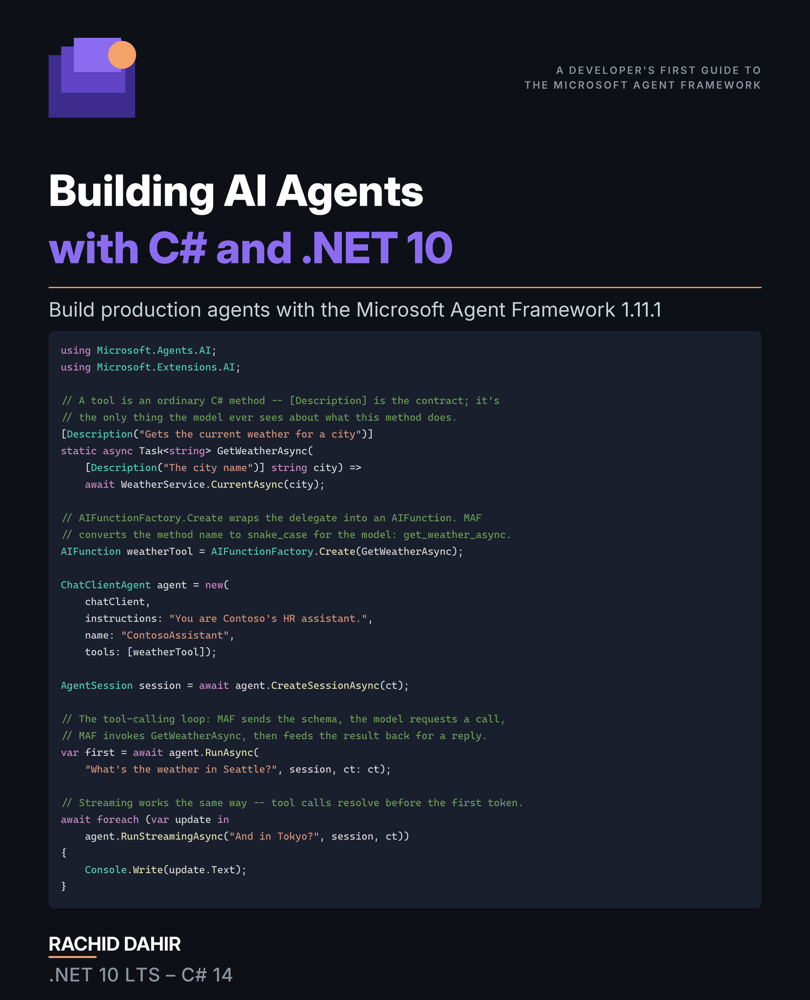

# Building AI Agents with C# and .NET 10

<p align="center">
  
</p>

<p align="center"><strong>A Developer's First Guide to the Microsoft Agent Framework</strong></p>

<p align="center"><em>From your first call to an LLM to a production-hosted, observable, safety-filtered multi-agent system — in C# 14 and .NET 10.</em></p>

<p align="center"><strong>📖 <a href="https://leanpub.com/buildingAIAgentsWithCSandNet10">Read it on Leanpub</a> — pay what you want.</strong></p>

<p align="center"><sub>The book itself ships through Leanpub. This repository hosts the companion code, errata, and reader feedback.</sub></p>

---

## What's in this book

The **Microsoft Agent Framework (MAF)** is Microsoft's unified, production-minded SDK for building AI agents in .NET — the consolidation of Semantic Kernel and AutoGen into one stack. This is the developer's first guide to it, built entirely on the **stable 1.11 release** and **.NET 10 / C# 14**.

Across nineteen chapters in five parts you go from your first call to an LLM, through tools and function calling, the Model Context Protocol, retrieval-augmented generation, and **multimodal agents** (vision), into multi-agent orchestration and workflows, all the way to hosting, observability, safety guardrails, agent skills, and evaluation. Every concept is anchored in a runnable companion project in this repository, and every code listing targets **MAF 1.11** — no preview ceremony.

## Table of Contents

| # | Chapter | Part |
|---|---------|------|
| 1 | The AI Revolution in .NET | **I — Foundations** |
| 2 | C# Essentials for AI Development | I |
| 3 | How LLMs Work: A Developer's Mental Model | I |
| 4 | Setting Up Your Dev Environment | I |
| 5 | Hello, Agent! | **II — Your First Agents** |
| 6 | Conversations and Memory | II |
| 7 | Structured Output and Typed Responses | II |
| 8 | Tools and Function Calling | **III — Giving Agents Superpowers** |
| 9 | The Model Context Protocol | III |
| 10 | Introduction to RAG | III |
| 11 | Multimodal Agents | III |
| 12 | Multi-Agent Systems | **IV — Multi-Agent Collaboration** |
| 13 | Introduction to Workflows | IV |
| 14 | Hosting and Deployment | **V — Going to Production** |
| 15 | Observability and Debugging | V |
| 16 | Safety and Guardrails | V |
| 17 | Agent Skills | V |
| 18 | Evaluation | V |
| 19 | Your Next Steps | V |

---

## Companion code

### Target stack

- **.NET 10** (LTS) / **C# 14**
- **Microsoft Agent Framework 1.11**
- **Microsoft.Extensions.AI 10.7.0**
- Visual Studio 2026, or VS Code with the C# Dev Kit

Every package version is pinned centrally in `Directory.Packages.props` (Central Package Management); individual `.csproj` files reference packages without version numbers. The full, themed package list is **Appendix A** of the book.

### Prerequisites

- [.NET 10 SDK](https://dotnet.microsoft.com/download/dotnet/10.0)
- A model provider. The samples default to **Ollama** running locally — zero cost, no API key — using **llama3.2**. They also support Azure OpenAI, OpenAI, GitHub Models, Anthropic, and Microsoft Foundry. Chapter 4 walks through each one.
- For the **multimodal** samples (Chapter 11), a vision-capable model — `ollama pull llava` locally, or a cloud `gpt-4o`-class model.

For the zero-config local default:

```bash
ollama pull llama3.2
```

### Clone & build

```bash
git clone https://github.com/RachidD68/building-ai-agents-with-csharp-and-dotnet-10.git
cd building-ai-agents-with-csharp-and-dotnet-10
dotnet build AgenticAI.slnx
```

Open `AgenticAI.slnx` once and every chapter's projects load together.

### Run a sample

```bash
dotnet run --project src/Ch05.HelloAgent/Ch05.BasicAgent
```

### Configuration

Provider settings live in each project's `appsettings.json`; secrets belong in a gitignored `appsettings.local.json` or in [.NET User Secrets](https://learn.microsoft.com/aspnet/core/security/app-secrets) — never in source control. For example, to use Azure OpenAI:

```bash
dotnet user-secrets set "AzureOpenAI:Endpoint" "https://YOUR-RESOURCE.openai.azure.com/"
dotnet user-secrets set "AzureOpenAI:ApiKey" "YOUR-KEY"
```

GitHub Models uses the endpoint `https://models.github.ai/inference` with publisher-prefixed model ids (e.g. `openai/gpt-4o-mini`). Azure/Foundry auth uses `DefaultAzureCredential` (run `az login` once for local dev; scope the credential chain in production).

### Repository layout

| Folder | Chapter | Topic |
|--------|---------|-------|
| `src/Common/` | — | Shared configuration, DI, provider wiring, resilience |
| `src/Ch01.*` | 1 | The AI Revolution in .NET (concept + a first code glimpse) |
| `src/Ch02.CSharpEssentials/` | 2 | C# Essentials for AI Development |
| `src/Ch03.HowLLMsWork/` | 3 | How LLMs Work |
| `src/Ch04.DevEnvironment/` | 4 | Setting Up Your Dev Environment |
| `src/Ch05.HelloAgent/` | 5 | Hello, Agent! |
| `src/Ch06.ConversationsMemory/` | 6 | Conversations and Memory |
| `src/Ch07.StructuredOutput/` | 7 | Structured Output and Typed Responses |
| `src/Ch08.ToolsFunctionCalling/` | 8 | Tools and Function Calling (incl. `FileAccessProvider`) |
| `src/Ch09.MCP/` | 9 | The Model Context Protocol |
| `src/Ch10.IntroRAG/` | 10 | Introduction to RAG |
| `src/Ch11.Multimodal/` | 11 | Multimodal Agents — vision, image-to-typed-data |
| `src/Ch12.MultiAgent/` | 12 | Multi-Agent Systems |
| `src/Ch13.Workflows/` | 13 | Introduction to Workflows |
| `src/Ch14.Hosting/` | 14 | Hosting and Deployment |
| `src/Ch15.Observability/` | 15 | Observability and Debugging |
| `src/Ch16.SafetyGuardrails/` | 16 | Safety and Guardrails |
| `src/Ch17.AgentSkills/` | 17 | Agent Skills |
| `src/Ch18.EvalSuite/`, `Ch18.FaqEval/`, `Ch18.EvalTests/` | 18 | Evaluation |
| `src/Ch19.NextSteps/` | 19 | Your Next Steps |
| `exercises/` | 2–16 | Worked exercise solutions (also indexed in Appendix E) |

## Errata & feedback

Spotted a typo, a code sample that won't compile, or an outdated API? Please open an [**errata report**](../../issues/new?template=errata.yml). Reader corrections are how the book gets better.

## License

Companion code released under the [MIT License](LICENSE). The book text is © 2026 Rachid Dahir and distributed via [Leanpub](https://leanpub.com/buildingAIAgentsWithCSandNet10).
